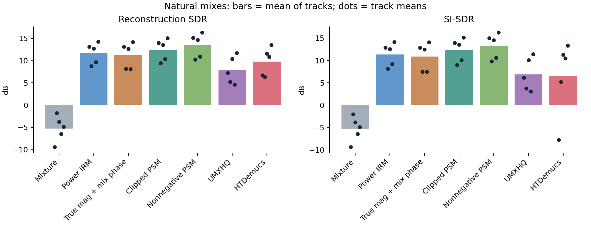

# Acoustic Limitations of Vocal Source Separation

**ELEC5305 project — Jiajun Liu, SID 550378323**

How do time-frequency overlap and mixture-phase mismatch constrain vocal
reconstruction, and how do pretrained separators behave when accompaniment gain
changes? This project reproduces oracle power-ratio masking and true-magnitude /
mixture-phase reconstruction, adds established phase-sensitive projection masks,
and compares official UMXHQ and HTDemucs implementations on identical inputs.

## Measured results

Five MUSDB18-HQ **test** tracks are selected alphabetically before scoring.
Two fixed six-second candidate excerpts per track produce nine active excerpts;
one nearly silent vocal excerpt is excluded by a declared -50 dBFS threshold.
Natural balance plus -10, 0 and +10 dB vocal-to-accompaniment ratios give **36 paired
inputs and 252 method/condition rows**. Repeated remixes are not independent songs.

| Method | Natural-mix reconstruction SDR | Stereo SI-SDR |
|---|---:|---:|
| Mixture control | -5.26 dB | -5.31 dB |
| Power IRM (oracle) | 11.69 dB | 11.36 dB |
| True magnitude + mixture phase (oracle) | 11.26 dB | 10.88 dB |
| Clipped phase-sensitive mask (oracle) | 12.47 dB | 12.33 dB |
| Nonnegative phase-sensitive mask (oracle) | 13.46 dB | 13.24 dB |
| Open-Unmix UMXHQ | 7.84 dB | 6.89 dB |
| HTDemucs | 9.79 dB | 6.51 dB |

Natural scores average excerpts **within each track**, then equally across tracks.
Clipped PSM improves on power IRM by **0.779 dB** mean reconstruction SDR.
True magnitude with mixture phase is not a universal oracle ceiling: adapting
amplitude to phase can reduce error. The coefficient identity `E_mag = 2 D_phi`
is verified to floating-point precision, but it is not a waveform-error bound.

These are a small, short-context case study, not full MUSDB benchmark scores.
Oracles require true stems. Learned systems receive only the mixture. Official
`htdemucs` used MUSDB plus **800 extra training songs**, so the model comparison
does not isolate architecture or phase modeling. A targeted iteration adds six seconds of surrounding context on each side and
scores the same centre six seconds. Over the nine natural excerpts, equal-track
mean reconstruction gains are **0.055 dB for UMXHQ** and **1.110 dB for HTDemucs**.
The weak HTDemucs case improves from approximately 0 to 8.84 dB, but not every
excerpt improves. Context and default split-window alignment change together.
No subjective listener scores or unperformed listening observations are claimed.



## Deliverables

- [Ten-page research report](output/pdf/ELEC5305_Project_Report_Jiajun_Liu.pdf)
- [Readable report source](output/pdf/report_source.md)
- [Per-case metrics](results/study/metrics.csv), [settings](results/study/run_manifest.json),
  [validation record](results/study/validation.json)
- [BSS Eval v4 cross-check](results/study/museval.csv), [failure diagnostics](results/study/failure_diagnostics.csv)
- [Video chapters and captions](output/video/video_chapters.json). The generated MP4
  and comparison WAVs are in the local delivery package, rather than source control.
- [Assessment requirements](docs/requirements_and_rubric.md)

## Final submission files

The final submission consists of the research report, the recorded English video,
and the GitHub source-code link. The report is linked above. The final MP4 is
submitted separately and is not stored in Git. It is the student's original English screen recording; the original recording is
retained without edits. The editable slides and bilingual recording notes are optional supporting
files, not substitutes for the report or video.

The presentation's short command `python -m src.study --help` delegates to the
same implementation as `python -m src.run_experiment --help`.

## Install

Use **Python 3.12** and run commands from the repository root. The versions below
were tested on Apple Silicon CPU; no CUDA or training is required.

```sh
python3.12 -m venv .venv
source .venv/bin/activate
python -m pip install -r requirements.txt
python -m pytest -q
```

`requirements-lock.txt` records the complete local environment. For report/video
regeneration, also install `requirements-report.txt`. PDF visual checks use Poppler (`pdftoppm`) separately. The main numerical workflow
does not need ffmpeg or ffprobe: the BSS Eval entry point loads the installed,
unmodified museval numerical module directly, avoiding its dataset-wrapper imports.

## Get the same test data and pretrained weights

```sh
python tools/download_subset.py --tracks 5
python tools/cache_models.py
```

The downloader requires `curl` on PATH, reads the official ZIP central directory,
fetches only the first five test tracks (about 777 MB compressed), and validates
WAV length and CRC32. It uses bounded parallel range requests and retries.
Already extracted tracks are reused. Track provenance is in
`data/MUSDB18-HQ/subset_manifest.json`; a copy accompanies the recorded results.
Alternatively place the complete dataset under `data/MUSDB18-HQ/`.
Data and weight caches are excluded from Git. Follow the educational-use and
individual recording terms on the [official dataset page](https://doi.org/10.5281/zenodo.3338373).

## Reproduce the study

```sh
python -m src.run_experiment
python -m src.summarize
python -m src.failure_analysis
python -m src.example_figures
python -m src.evaluate_museval
python -m src.context_experiment
python -m src.context_summary
python tools/build_project_report.py
python tools/validate_results.py
```

The defaults reproduce the documented 5-track study. The first run evaluates two
pretrained models on 36 inputs. Subsequent runs reuse numerical model checkpoints
bound to the input hash and source signature. Use a new `--output` directory after
changing scientific processing code; stale checkpoints are rejected.

For a quick oracle-only demonstration:

```sh
python -m src.run_oracle_demo --starts 30 --duration 6 --output results/quick_oracle
```

For the actual demonstration and captioned video:

```sh
python -m src.demo
python tools/build_demo_video.py
```

The video uses timestamped output captured from a real run, includes fixed
level-matched sound examples plus the context comparison, and explains the main findings and limitations.
It has captions and music, without spoken narration. Short terminal pauses are
extended for readability. The movie is written to
`output/video/ELEC5305_Project_Demo.mp4`.

## Separate your own audio without reference stems

```sh
python -m src.separate input.wav --model htdemucs --output results/my_song
```

Mono inputs are duplicated to stereo; audio is resampled to 44.1 kHz if needed.
This writes mixture, estimated vocals and residual accompaniment using one common
playback gain. It requires no clean stems. Choose `--model openunmix` for UMXHQ.
Scores are available only when true reference stems exist.

## Interpretation and technical details

- Analysis STFT: periodic Hann, 2048 FFT, 512 hop, centered zero padding. Sensitivity
  checks also use 1024/256 and 4096/1024. Model-native transforms are preserved.
- Every experimental input is `vocals + gain * (drums + bass + other)`.
  The original quantized mixture-versus-stem-sum discrepancy is retained in CSVs.
- Power IRM means exponent **one**; other papers sometimes use a square root.
- Reconstruction SDR is `10 log10(sum(v²) / sum((v-vhat)²))`, with no gain/delay fit.
- SI-SDR concatenates stereo after per-channel demeaning and fits one shared scalar.
- BSS Eval v4 uses vocal/accompaniment source images, 1 s windows/hops, 512-tap
  filters fixed across an excerpt, no permutation and median-window aggregation.
  The mixture control is omitted because its zero residual violates museval's
  non-silent-source validation. No artificial noise is inserted.
- UMXHQ: all four target networks, one multichannel Wiener iteration, native
  4096/1024 STFT. HTDemucs: official `htdemucs`, shifts=0, split=True,
  overlap=0.25, shared author preprocessing. Both use CPU and four Torch threads.
- Timing excludes model loading/download. Reported values are not hardware-independent.
- Accompaniment gain changes VAR, overlap and phase mismatch together. Correlations
  are descriptive; the design does not identify their independent causal effects.
- A notable failure is a very weak HTDemucs output on the first track's 60 s
  excerpt. Reconstruction SDR near zero and SI-SDR near -28.7 dB expose different
  aspects of that error. The report does not characterize all tracks by this case.

## Source map and attribution

`src/audio_utils.py` handles validated segment reads; `stft_utils.py` handles
reconstruction; `oracle_methods.py` contains the masking reproduction and extension;
`models.py` adapts unmodified author packages; `run_experiment.py` controls paired
experiments; `summarize.py` and `failure_analysis.py` analyse measured outputs.
Thirteen tests check signal-processing invariants and invalid input handling.

Phase-sensitive masking is credited to Erdogan et al. (ICASSP 2015), and the
interpretation of SDR to Le Roux et al. (ICASSP 2019). Open-Unmix, HTDemucs,
MUSDB18-HQ and museval retain their respective author credits and licenses.
The report contains the full reference list and acknowledges AI-assisted code,
analysis and report drafting. The contribution is the controlled experiment and
interpretation, not invention of these established methods or training new models.
