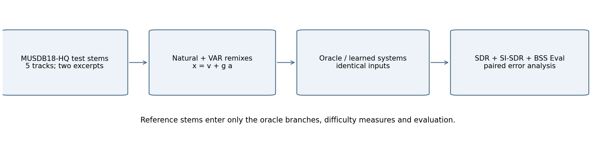
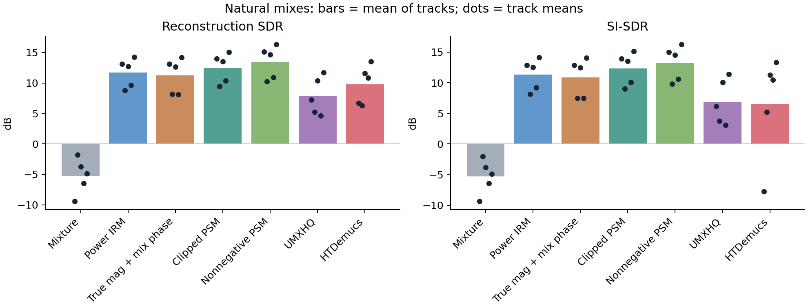
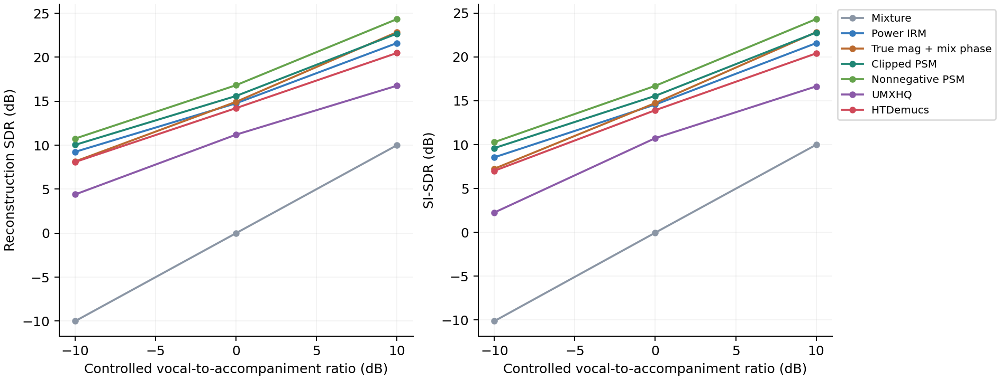
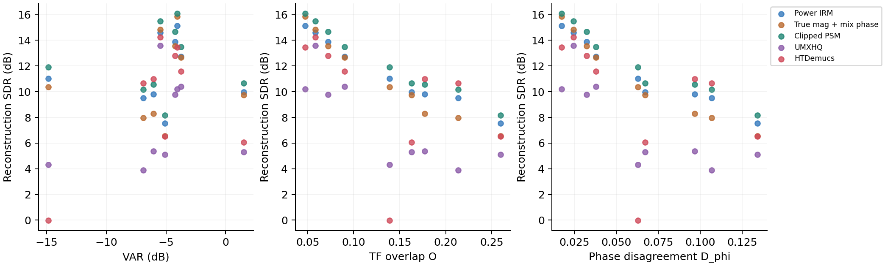
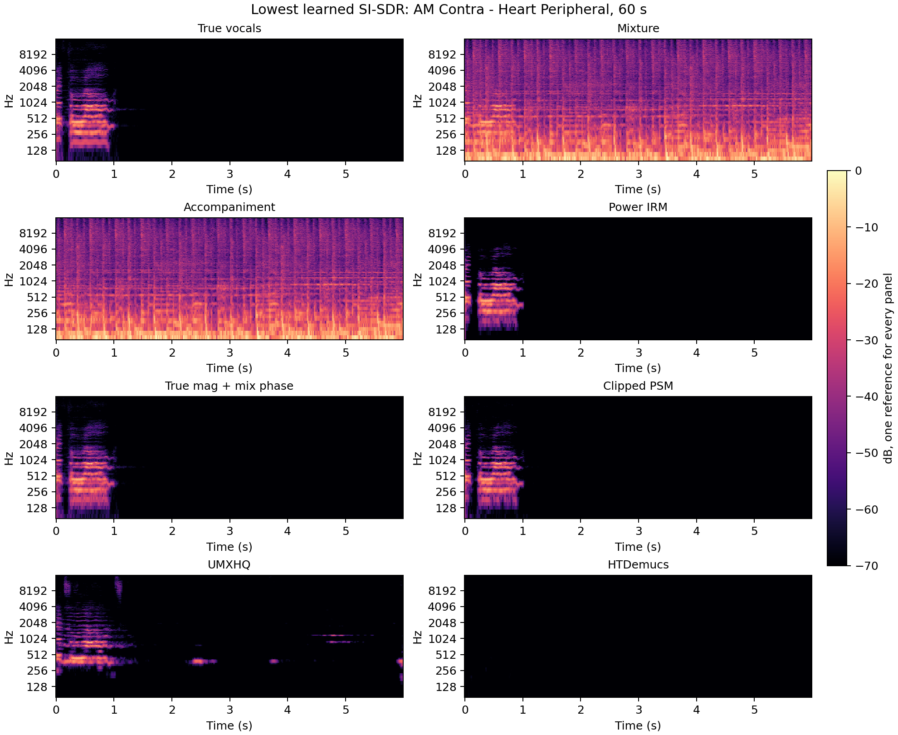

<b>Time-frequency overlap, mixture phase and pretrained reference systems</b>

Jiajun Liu | SID 550378323 ELEC5305 Acoustics, Speech and Signal Processing 8 November 2026

## Abstract

This study asks how overlap and mixture-phase mismatch relate to vocal-separation error. Four oracle reconstructions and two pretrained systems are evaluated on 9 six-second excerpts from 5 MUSDB18-HQ test tracks. Natural balances and controlled vocal-to-accompaniment ratios yield 36 paired inputs. A clipped phase-sensitive mask improves natural-mix reconstruction SDR over a power ideal ratio mask (IRM) by 0.78 dB on average. An exact coefficient-error identity verifies the phase diagnostic, while the difference after inverse STFT shows why it is not a waveform bound. UMXHQ and HTDemucs provide practical references. The experiment supports a conditional account of separation difficulty, rather than a universal ranking or a subjective quality claim.

# 1. Introduction and research question

Vocal extraction supports karaoke, remixing and analysis, but musical sources can share harmonics, transients and stereo positions. A stronger model can exploit learned regularities; it cannot make overlap and destructive interference irrelevant. Comparing a hand-designed mask with a neural network alone obscures this issue, because many neural separators also estimate spectral representations.

<b>Research question:</b> How do time-frequency overlap and mixture-phase mismatch constrain oracle magnitude-mask reconstruction, and do two pretrained vocal separators exhibit similar difficulty trends under controlled accompaniment gain changes?

The project reproduces the original power-IRM and true-magnitude baselines, adds two established phase-sensitive oracle variants, and compares them on matched inputs. The contribution is the controlled musical analysis and verified implementation, not the invention of phase-sensitive masking or a newly trained network. The scope is deliberately limited to short excerpts and a small test subset.

## Contents

1 Introduction and question - p. 1 | 6 Natural-mixture results - p. 6
2 Literature review - p. 2 | 7 Controlled balance and phase - p. 7
3 Data and paired conditions - p. 3 | 8 Failure, context and sensitivity - p. 8
4 Oracle constraints and modification - p. 4 | 9 Discussion and limitations - p. 9
5 Evaluation and implementation - p. 5 | 10 Conclusion and references - p. 10

---

# 2. Literature review and rationale

## 2.1 Magnitude masks and phase-sensitive objectives

Wang and Chen [1] organize supervised separation around targets such as binary masks, ratio masks, spectral magnitudes and phase-sensitive masks. These targets impose different constraints; the term IRM also has multiple exponent conventions. This project fixes the power ratio with exponent one. Its appeal is a smooth, bounded attenuation mask, but its source-power denominator omits the instantaneous cross term in mixture power. Therefore an oracle power mask need not minimize the error of a particular mixture realization.

Erdogan et al. [2] show that using mixture phase changes the amplitude that minimizes complex-spectrum error. Matching the true target magnitude is consequently not always optimal. Their work motivates projecting the target coefficient onto the mixture direction. Here the projection is implemented directly from known music stems, first clipped to [0,1], then allowed nonnegative amplification. This reproduces the masking idea, not their trained speech recognizer or recurrent-network experiments. The comparison tests which restriction matters in music.

## 2.2 Learned spectral and hybrid reference systems

Open-Unmix [3] provides an accessible, reproducible separation reference. Its bidirectional recurrent magnitude estimator and multichannel Wiener reconstruction [4] supply a useful learned spectral contrast. The present UMXHQ configuration predicts all four stems and uses one Wiener iteration. Calling it a fixed mixture-phase mask would be inaccurate: its multichannel reconstruction is more general than the scalar oracle masks used here. Short excerpts also remove context available in full-track inference.

HTDemucs [5] exchanges information between waveform and spectral branches through attention. It is selected to test a different representation and context mechanism. The paper distinguishes architecture, additional training data and fine-tuning effects; these factors prevent attributing every gain to phase modeling. In particular, this is not a matched-training-data architecture comparison. This study uses the official htdemucs checkpoint [6], trained on MUSDB plus 800 extra songs, without fine-tuning or random shift averaging. It is a reference configuration, not a reproduction of the paper's strongest published result.

Later complex-spectral systems such as BS-RoFormer [7] further undermine a simple "spectral versus deep learning" distinction. Its band-wise attention and complex representation suggest a useful future reference, but it is not evaluated here. Neither selected model is presented as the current state of the art.

## 2.3 Measurement and the local research gap

Le Roux et al. [8] explain why SDR definitions and scale conventions can produce misleading comparisons. This motivates reporting reconstruction SDR, explicitly defined stereo SI-SDR and separate BSS Eval v4 scores. The local question is not whether a published method is globally superior, but whether measurable acoustic variables help explain errors on paired examples. The experiment joins interpretable oracle constraints with fixed pretrained systems; it does not claim that this question has never been studied.

Approach | Useful property | Key limitation
Power IRM / phase oracles | Known-reference diagnosis | Unavailable without stems
UMXHQ | Reproducible spectral reference | Learned priors; context dependent
HTDemucs | Hybrid waveform/spectral processing | Different architecture and training recipe

---

# 3. Methods: data and paired conditions

## 3.1 Deterministic test subset

MUSDB18-HQ supplies 44.1 kHz stereo mixtures and vocal, drum, bass and other stems [9]. The lexicographically first five official test tracks are selected before inspecting separation scores. Two fixed excerpts, starting at 30 and 60 seconds and lasting six seconds each, give ten candidate excerpts. A vocal RMS threshold of -50 dBFS rejects effectively silent targets; exclusions and their reasons are saved in the run manifest. This is a convenience subset, not a representative random sample of music.

Official test track | Excerpt intervals (s)
AM Contra - Heart Peripheral | 30-36; 60-66
Al James - Schoolboy Facination | 30-36; 60-66
Angels In Amplifiers - I'm Alright | 30-36; 60-66
Arise - Run Run Run | 30-36; 60-66
BKS - Bulldozer | 30-36; 60-66

The 60-second Angels In Amplifiers excerpt is excluded by the vocal-activity rule, leaving nine active excerpts. Official-archive WAVs are verified by uncompressed length and CRC32. No training track is used in the reported evaluation; the subset manifest records provenance.

## 3.2 Exact mixtures and gain intervention

For each stereo excerpt, v denotes vocals and a is drums + bass + other. Experimental inputs are reconstructed as x = v + ga for every system. This avoids treating independently quantized mixture files as exactly additive. The original file-versus-stem-sum relative discrepancy is measured separately; its maximum is 5.18e-04. Scores use the unscaled true vocal reference.

$$\mathrm{VAR}=10\log_{10}\frac{\sum_{n,c}v_c[n]^2}{\sum_{n,c}a_c[n]^2},\qquad g=10^{(\mathrm{VAR}_{native}-\mathrm{VAR}_{target})/20}$$

Each base excerpt is used at its native balance and at -10, 0 and +10 dB target VAR. Only the accompaniment amplitude changes. The resulting 36 inputs are paired across all seven methods. Repeated mixtures of one excerpt are not treated as independent songs. VAR, overlap and phase mismatch change together; gain is the controlled intervention, whereas their individual causal effects are not separately identified.

## 3.3 Shared analysis transform

The analysis uses a periodic Hann window, a 2048-point FFT and a 512-sample hop, with centred constant padding. Stereo channels are transformed separately and inverted to the exact original length. Natural excerpts are additionally processed at 1024/256 and 4096/1024 FFT/hop settings to test representation sensitivity. Learned models retain their author-defined native transforms; changing them would invalidate the pretrained weights.

---

# 4. Methods: oracle constraints and the modification

## 4.1 Reproduced baselines

$$X=V+A,\qquad M_{IRM}=\frac{|V|^2}{|V|^2+|A|^2},\qquad \widehat V_{IRM}=M_{IRM}X$$

All coefficients are per channel, frequency and frame. Bins with zero total source power receive mask zero. The original power-IRM implementation uses true source powers, so it measures a representation-and-mask reference rather than blind separation performance. The input mixture itself is included as a no-separation control.

$$\widehat V_{mag}=|V|e^{j\angle X},\quad D_{\phi}=\frac{\sum |V|^2[1-\cos(\angle V-\angle X)]}{\sum |V|^2}$$

The second baseline keeps the exact target magnitude and replaces target phase with mixture phase. It isolates the coefficient error of that substitution, but is not the best possible waveform reconstruction achievable by every magnitude-based model.

## 4.2 Small modification: phase-sensitive projection

$$m^*=\frac{\operatorname{Re}(V X^*)}{|X|^2}=\frac{|V|}{|X|}\cos(\angle V-\angle X)$$

Minimizing |mX - V| squared over real m gives this projection [2]. Clipping m* to [0,1] gives the optimum within the ordinary attenuation-mask interval. A second version clips only below zero, allowing amplification. Zero-mixture bins receive mask zero. In every case the estimate is mX; no true phase is inserted during synthesis.

This modification uses the same signals and STFT as the reproduced IRM. Its purpose is to separate errors due to source-power masking from errors imposed by the nonnegative mixture-direction constraint. It is an oracle extension of the experiment. It cannot be applied to an unknown song without estimating the missing target information.

## 4.3 Why magnitude accuracy is insufficient

$$\frac{\sum|\widehat V_{mag}-V|^2}{\sum|V|^2}=2D_{\phi}$$

This coefficient identity follows by expanding the squared distance between two equal-length complex vectors. It is checked numerically. A phase-sensitive amplitude can shorten a badly oriented coefficient and reduce its error, even though its magnitude becomes less accurate. When cancellation makes |X| smaller than |V|, a mask capped at one cannot restore the lost magnitude. When the target points against X, a nonnegative mask cannot reverse direction.

These statements concern coefficient geometry. Overlapping STFT coefficients are redundant and modified spectra need not be consistent with a waveform. Inverse STFT projects them back to an audio signal, so coefficient-wise optimality is not a universal guarantee of highest waveform SDR. The paired measured results are needed to establish the actual waveform effect.

---

# 5. Methods: difficulty, evaluation and implementation

## 5.1 Acoustic difficulty and waveform metrics

$$O=\frac{\sum\min(|V|^2,|A|^2)}{\sum|V|^2},\qquad 0\leq O\leq1$$

O measures accompaniment energy occupying vocal-energy bins. It depends on relative levels as well as spectral occupancy; it is not a level-invariant overlap index. D_phi ranges from zero to two and weights phase mismatch by vocal energy. Both descriptors use all channels and bins of the same analysis STFT. Natural-mix scatterplots and descriptive Spearman correlations complement the controlled gain sweep.

$$\mathrm{SDR}_{rec}=10\log_{10}\frac{\|v\|^2}{\|v-\widehat v\|^2}$$

Reconstruction SDR fits no gain, delay or distortion filter. It penalizes vocal attenuation and interference together. SI-SDR first demeans each channel, concatenates the two channels, and fits one shared scalar projection onto the reference. The same operation is used for every method. This is an explicitly stated stereo extension of SI-SDR [8]; it is not the average of two independently rescaled mono scores.

BSS Eval v4 [10] separately evaluates two source images: vocals and accompaniment, with estimated accompaniment defined as mixture minus estimated vocals. It uses one-second nonoverlapping score windows, 512-tap distortion filters fixed across each excerpt, no permutation search and the image formulation. The mixture control is omitted here because its exactly zero accompaniment estimate is rejected by museval; no artificial noise is added. The median valid vocal SDR across windows is retained. These short-excerpt settings differ from whole-track benchmark aggregation, so published benchmark numbers are not directly comparable.

## 5.2 Fair inference and aggregation

UMXHQ uses four target networks, its native 4096-point STFT / 1024 hop and one multichannel Wiener iteration. HTDemucs uses the htdemucs checkpoint with the official shared mean/standard-deviation preprocessing, split inference and 25% overlap. Random time shifts are disabled. Both run on CPU with four Torch threads. A targeted iteration gives both models 18-second inputs with six seconds of context on each side, scores only the original centre six seconds, and repeats this for all nine natural excerpts. No model is retrained or fine-tuned.

Scores are computed before playback gain. Natural-mix scores are averaged over the retained excerpts within each track, then equally across tracks. Each track retains at most two excerpts. Track dots expose variability; controlled curves use the same complete paired set at every VAR. Correlations are descriptive and have no independent-sample p-values. Model timing excludes initial download and loading, and is not a general hardware benchmark.

## 5.3 Reproducibility and checks

The pipeline reads only requested WAV frames, checks sample rate, length and channel alignment, and rejects invalid intervals. Checkpoints bind each model output to a code signature and input hash. CSVs retain per-case scores, acoustic variables, gains and runtime; manifests retain package versions and settings. Thirteen automated tests cover reconstruction, phase identities, cancellation, zero bins, scale conventions and stem alignment. The maximum measured STFT relative reconstruction error is 2.05e-16. WAV comparisons share a single gain per excerpt and use floating-point storage.

---

# 6. Results: natural musical mixtures

Method | Rec. SDR (dB) | SI-SDR (dB) | Track range (rec.)
Mixture | -5.26 | -5.31 | -9.45 to -1.79
Power IRM | 11.69 | 11.36 | 8.74 to 14.25
True magnitude + mixture phase | 11.26 | 10.88 | 8.13 to 14.20
Clipped PSM | 12.47 | 12.33 | 9.41 to 15.09
Nonnegative PSM | 13.46 | 13.24 | 10.24 to 16.35
UMXHQ | 7.84 | 6.89 | 4.63 to 11.69
HTDemucs | 9.79 | 6.51 | 6.30 to 13.53

Table 1. Means over tracks at the native mix balance; ranges are minimum and maximum track means, not confidence intervals.

The reproduced power IRM reaches 11.69 dB mean reconstruction SDR. Clipped PSM reaches 12.47 dB, a paired improvement of 0.78 dB. Across the retained excerpts the gain ranges from 0.65 to 0.94 dB. Allowing nonnegative amplification gives 13.46 dB. These values support a measurable cost of the original mask constraints on this subset.

The true-magnitude/mixture-phase reconstruction obtains 11.26 dB. Its ordering relative to the projection masks is consistent with the fact that exact magnitude is not the coefficient-error optimum when phase is wrong. UMXHQ and HTDemucs obtain 7.84 and 9.79 dB respectively. Their gap includes architecture, priors and reconstruction differences; the data do not isolate any one cause.

The separate median-window BSS Eval v4 cross-check gives Power IRM 9.74 dB, Clipped PSM 10.63 dB, UMXHQ 2.89 dB, HTDemucs 6.61 dB. Differences from Table 1 reflect window aggregation and metric definitions, rather than another separation run.

---

# 7. Results: controlled balance and phase error

The controlled inputs preserve musical content and alignment while changing accompaniment strength. The no-separation control equals target VAR by construction, providing a direct check of the gain implementation. Actual measured means at -10, 0 and +10 dB are -10.00, 0.00, 10.00 dB.

For IRM the corresponding reconstruction scores are 9.24, 14.76, 21.61 dB; for clipped PSM they are 10.04, 15.59, 22.68 dB. The paired design establishes sensitivity to accompaniment gain. It cannot tell whether overlap or phase mismatch alone caused a model's degradation, since both change when the same accompaniment is scaled.

The scatterplots retain the natural content variability rather than combining all remixes into an apparently large independent sample. The maximum absolute residual of the coefficient identity is 1.11e-16. This verifies the calculation of D_phi and the true-magnitude oracle. The identity is partly definitional, so its verification is a correctness check rather than new empirical evidence of a causal relation. Waveform results carry the substantive test.

---

# 8. Results: failure inspection and sensitivity

A common scale avoids hiding attenuation by per-panel normalization. In AM Contra - Heart Peripheral at 60 s, HTDemucs gives -0.00 dB reconstruction SDR but -28.72 dB SI-SDR. Its demeaned output/reference RMS ratio is 0.0038. The very weak, poorly aligned estimate approaches the zero-output reconstruction error, explaining why a near-zero reconstruction SDR can coexist with very low SI-SDR. This is an observed failure case, not a listening rating or a model-wide characterization.

The targeted context iteration raises this failed-case HTDemucs score from -0.00 to 8.84 dB. Across all nine natural excerpts, equal-track mean gains are 0.05 dB for UMXHQ and 1.11 dB for HTDemucs. Not every excerpt improves. Added context and Demucs split-window alignment change together, so this is an inference-configuration improvement, not proof of a single cause.

The STFT sensitivity experiment gives IRM means of 10.28, 11.58, 12.41 dB for 1024, 2048 and 4096 points respectively. The complete plot is supplied with the results. Frequency resolution, transient smearing and overlap change together. The sweep tests robustness of the interpretation; the best setting on these excerpts is not claimed to be generally optimal.

Reference, mixture, oracle and learned WAVs are available for the first excerpt of every track with one shared playback gain. The video includes fixed excerpts from the first selected track. These sound examples support informal inspection and demonstration, not population-level preference claims.

---

# 9. Discussion: what the experiments establish

## 9.1 Interpreting the modification

The phase-sensitive comparison makes the failure mechanism more specific than "the sources overlap." Power IRM uses source energies but ignores instantaneous relative phase. The constrained projection uses the direction of the actual mixture coefficient. Its measured gain shows that part of the IRM error can be reduced without directly replacing mixture phase. This is consistent with the amplitude-phase interaction in [2], while extending the local demonstration to stereo musical stems. It is not evidence for an algorithmically novel separator.

The nonnegative unbounded projection isolates a second restriction: attenuation-only masks cannot increase a cancelled mixture coefficient. Its additional gain points to the cost of the upper mask cap. A remaining error still exists because a nonnegative multiplier cannot rotate a coefficient to an arbitrary target phase. Thus a larger magnitude error can coexist with a smaller complex or waveform error. This is why "true magnitude plus mixture phase" must not be called an absolute oracle ceiling for all learned systems.

## 9.2 Relating oracle and learned behavior

A learned separator infers target structure from data rather than observing true stems. Overlap and phase descriptors therefore cannot capture every source of error: timbre, arrangement, stereo image, training distribution and excerpt boundaries matter. UMXHQ adds multichannel Wiener reconstruction, and HTDemucs combines temporal and spectral pathways. Neither fits the same scalar-mask constraint as the baseline. A learned model exceeding IRM on an example would not contradict the oracle calculations; falling below IRM would not identify phase as the sole bottleneck.

The controlled gain sweep answers a narrower causal question: how outputs change when accompaniment strength changes for fixed content. Correlated increases in O and D_phi describe this intervention. Natural-mix correlations additionally include content changes and cannot establish independent physical causes. The phase identity shares terms with its diagnostic by construction; reporting it as a predictive discovery would overstate the experiment.

## 9.3 Limitations, criticism and next experiments

Five alphabetically selected tracks and two fixed candidate six-second intervals provide a reproducible case study, not a random or comprehensive benchmark. The repeated remixes represent only 9 retained excerpts from five tracks. There are no justified population confidence intervals, model-significance claims or genre-general conclusions. A stronger replication would predefine a larger stratified test sample and use track-level uncertainty estimates. Silent-vocal segments would require separate false-positive measures rather than an undefined target SDR.

Short inference windows remove full-song context, especially relevant to the bidirectional UMX network. The measured context iteration supports testing inference boundaries before blaming all failures on overlap or phase. Its heterogeneous effects argue against a universal context gain. A full-track control and fixed split alignment would better separate these factors. Phase statistics remain representation dependent, as the STFT sweep illustrates.

The default HTDemucs checkpoint used 800 additional training songs, while UMXHQ did not use that same extra corpus. Architecture-only superiority cannot be inferred from this comparison. Signal-distance scores cannot establish intelligibility, absence of musical noise or listener preference. A blinded, level-matched listening comparison would be needed. Further work should also separate level from spectral overlap, compare complex-mask references, and evaluate a contemporary band-split model under explicitly matched training-data and metric conditions. Starting again, the most valuable early step would be a verified one-track pipeline and a fixed manifest, before expanding the model list.

---

# 10. Conclusion

The project produced a reproducible vocal-separation investigation with 36 paired musical inputs, two pretrained references and explicit signal-level evaluation. On native mixtures, clipping the phase-sensitive projection improves on power IRM by 0.78 dB mean reconstruction SDR. The verified phase identity and the amplification ablation explain why exact target magnitude with mixture phase is neither a guarantee of optimal reconstruction nor a universal learned-model ceiling. Controlled gain changes expose conditional difficulty trends, while the small subset, coupled descriptors and short context limit generalization. A targeted context iteration also improves a short-input failure without retraining. The conclusions remain conditional on these examples, with broader acoustic and perceptual validation still needed.

# References

[1] Wang D, Chen J. Supervised speech separation based on deep learning: an overview. IEEE/ACM TASLP. 2018;26(10):1702-1726. <link href="https://doi.org/10.1109/TASLP.2018.2842159" color="#245f89">Source</link>.

[2] Erdogan H, Hershey JR, Watanabe S, Le Roux J. Phase-sensitive and recognition-boosted speech separation using deep recurrent neural networks. ICASSP. 2015. <link href="https://www.jonathanleroux.org/pdf/Erdogan2015ICASSP04.pdf" color="#245f89">Source</link>.

[3] Stoter FR, Uhlich S, Liutkus A, Mitsufuji Y. Open-Unmix: a reference implementation for music source separation. JOSS. 2019;4(41):1667. <link href="https://doi.org/10.21105/joss.01667" color="#245f89">Source</link>.

[4] SigSep. Open-Unmix technical documentation and PyTorch implementation, version 1.3.0. Accessed 8 November 2026. <link href="https://github.com/sigsep/open-unmix-pytorch" color="#245f89">Source</link>.

[5] Rouard S, Massa F, Defossez A. Hybrid transformers for music source separation. ICASSP. 2023. Preprint arXiv:2211.08553. <link href="https://arxiv.org/abs/2211.08553" color="#245f89">Source</link>.

[6] Meta AI. Demucs author implementation, version 4.0.1; htdemucs checkpoint 955717e8-8726e21a. Accessed 8 November 2026. <link href="https://github.com/facebookresearch/demucs" color="#245f89">Source</link>.

[7] Lu WT, Wang JC, Kong Q, Hung YN. Music source separation with band-split RoPE transformer. arXiv:2309.02612v2. 2023. <link href="https://arxiv.org/abs/2309.02612" color="#245f89">Source</link>.

[8] Le Roux J, Wisdom S, Erdogan H, Hershey JR. SDR: half-baked or well done? ICASSP. 2019:626-630. <link href="https://arxiv.org/abs/1811.02508" color="#245f89">Source</link>.

[9] Rafii Z, Liutkus A, Stoter FR, Mimilakis SI, Bittner R. MUSDB18-HQ: an uncompressed version of MUSDB18. Zenodo. 2019. <link href="https://doi.org/10.5281/zenodo.3338373" color="#245f89">Source</link>.

[10] SigSep. museval: BSS Eval v4 implementation, version 0.4.1. Accessed 8 November 2026. <link href="https://github.com/sigsep/sigsep-mus-eval" color="#245f89">Source</link>.

## Code, data and assistance

Code and reproduction instructions accompany this report. The existing project repository is <link href="https://github.com/JiajunLiu-June/elec5305-project-530878323" color="#245f89">JiajunLiu-June/elec5305-project-530878323</link>. Original course project work was extended with AI-assisted implementation, analysis and report drafting; this assistance is acknowledged. Model authors retain credit for pretrained systems, and phase-sensitive masking is attributed to prior work. No formal listener ratings or personal listening observations are fabricated. Source audio is obtained separately under MUSDB18-HQ terms, rather than included in the GitHub source archive.